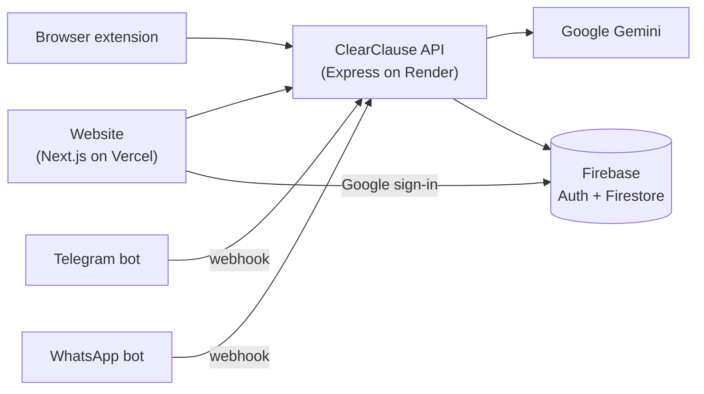
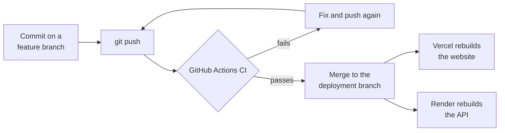

# ClearClause

**Know what you're agreeing to.** ClearClause reads contracts, terms and conditions and privacy policies, checks them against South African law, and explains every problem clause in plain language, in any of the 11 official languages.

**Live:** [clear-clause-green.vercel.app](https://clear-clause-green.vercel.app). A move to a `.co.za` domain is planned (see [Moving to a .co.za domain](#moving-to-a-coza-domain)).

| | |
|---|---|
| **Website** | Next.js 16, hosted on Vercel |
| **API** | Node.js + Express 5, hosted on Render |
| **AI** | Google Gemini, with automatic fallback between models |
| **Accounts and data** | Firebase Authentication (Google sign-in) and Cloud Firestore |
| **Other channels** | Browser extension (Chrome and Firefox), Telegram bot, WhatsApp bot |

---

## What it does

1. **Takes any document.** You can upload a PDF, a Word file or a photo, paste text, or paste a link to a terms page.
2. **Checks it against seven South African laws:**
   - POPIA (Protection of Personal Information Act)
   - CPA (Consumer Protection Act)
   - NCA (National Credit Act)
   - ECTA (Electronic Communications and Transactions Act)
   - BCEA (Basic Conditions of Employment Act)
   - LRA (Labour Relations Act)
   - Rental Housing Act
3. **Explains each finding.** Every flagged clause shows:
   - how serious it is: *breaks the law*, *unfair or risky* or *unclear wording*;
   - the exact words from the document, checked against the original text so the AI cannot invent a quote;
   - what it means and what you can do about it;
   - **the law involved**, with the sections cited and a one-line description of what that law protects.
4. **Scores the document.** It gets an overall risk score and a score for each law.
5. **Has two modes:**
   - *Signing it*, for people about to sign.
   - *The business*, for companies checking their own documents. It adds fix suggestions and safer replacement wording, and is part of the Business plan.

### Plans

| Plan | Allowance | Price |
|---|---|---|
| Guest (no account), WhatsApp and Telegram | 3 checks every 14 days | Free |
| Free account | 3 checks every 14 days, saved reports | Free |
| Pro | 50 checks a day | R79/month |
| Business | Unlimited, compliance mode, API access | From R1 490/month |

Allowances use a **rolling window**: each check counts for 14 days after it was used, then becomes available again. Paid plans are priced but online payment isn't connected yet.

---

## How it fits together



Every channel uses **one scan pipeline** ([backend/src/engine/pipeline.js](backend/src/engine/pipeline.js)). That way the website, extension, bots and Business API always give the same answer. The pipeline runs these steps in order:

1. **Extract text.** It reads PDF and Word files, and fetches links with protection against server-side request forgery. Scanned PDFs and photos go straight to the AI.
2. **Charge one check** from the plan's allowance.
3. **Analyse with Gemini**, using a strict JSON schema and a short brief on each of the seven laws.
4. **Verify every quote** against the source text, then score the result.
5. **Save the report** if the person is signed in. Documents themselves are never stored.

| Folder | What's in it |
|---|---|
| [frontend/](frontend/) | Website: scan, report, saved reports, account, pricing, privacy and example pages |
| [backend/](backend/) | API, analysis engine, plan limits, Telegram and WhatsApp bots, and tests |
| [extension/](extension/) | Browser extension (Manifest V3). See [extension/README.md](extension/README.md) |
| [firestore.rules](firestore.rules), [firestore.indexes.json](firestore.indexes.json) | Database security rules and indexes |
| [.github/workflows/ci.yml](.github/workflows/ci.yml) | Continuous integration |

---

## Continuous integration and deployment (CI/CD)



### Continuous integration

[`.github/workflows/ci.yml`](.github/workflows/ci.yml) runs on every push and every pull request. It has three jobs, and a newer push to the same branch cancels an older run.

| Job | What it checks |
|---|---|
| **Backend tests** | `npm ci`, then the full test suite (`npm test`). It runs with no secrets and no network: Firebase is switched off and storage falls back to memory. |
| **Frontend** | `npm ci`, ESLint, generation of Next's route types (`next typegen`), a TypeScript type-check (`tsc --noEmit`) and a full production build (`next build`). |
| **Browser extension** | The scripts parse, `manifest.json` is valid, and the popup contains no raw-HTML insertion (`innerHTML` and similar). The popup builds its interface only from text nodes, so text inside a contract can never run as code. |

Before the workflow was switched on, it was rehearsed step by step on a clean copy of the repository, with no `.env` files and no installed packages, to match what GitHub sees. The rehearsal caught two failures that a developer's machine had hidden:

- **The type-check failed on a fresh checkout.** Next.js generates some types (`PageProps`, `LayoutProps`) when the dev server runs, so `tsc` only passed on machines that had run it. The workflow now runs `next typegen` first.
- **The extension safety check flagged a code comment.** The comment mentions `innerHTML`, so the check was narrowed to real assignments and calls.

After those fixes, all three jobs passed: 22/22 backend tests, lint and type-check clean, the production build succeeded (10 routes), and the extension checks passed.

### Continuous deployment

| Part | Where | How it deploys |
|---|---|---|
| Website | Vercel ([clear-clause-green.vercel.app](https://clear-clause-green.vercel.app)) | Vercel builds `frontend/` from GitHub on every push and gives other branches their own preview URLs. |
| API | Render ([health check](https://clearclause-na7y.onrender.com/health)) | Render builds `backend/` from GitHub and runs `npm start`. Secrets live in Render's environment settings, never in the repository. |
| Database rules | Firebase | `firebase deploy --only firestore` publishes [firestore.rules](firestore.rules) and [firestore.indexes.json](firestore.indexes.json). |

Configuration is kept separate from code. The website only needs `NEXT_PUBLIC_API_URL`. The API reads its settings from environment variables, which are documented in [backend/.env.example](backend/.env.example). They cover:

- the Gemini key and fallback models;
- Firebase credentials;
- allowed website origins (CORS);
- plan limits;
- bot tokens.

The API's `/health` endpoint reports which services are configured, without revealing any secrets.

### What the Forth deployment taught us

The forth deployment, on 30 September 2026, took 12 "Deployment ready" and "errors" commits in one evening. Each fixed a problem that only appeared once the app ran outside a laptop:

| Problem found in deployment | Fix at the time | Where it ended up |
|---|---|---|
| The website called `http://localhost:5000`, which was hard-coded | API address read from `NEXT_PUBLIC_API_URL` | Still the approach today |
| Render couldn't find the Firebase key file (three attempts with different file paths) | Searched several paths, then used Render "Secret Files" | Replaced by `FIREBASE_SERVICE_ACCOUNT_JSON`, an environment variable with no file paths |
| The Telegram library broke on import because of an ES module / CommonJS mismatch (three attempts) | Changed how the library was imported | The bots were rebuilt to call the Telegram API directly, with no library |
| The bot's AI SDK version (`@google/genai` 0.1) was too old for the API | Upgraded to 2.x | One shared engine for all channels |

The code problems are the kind CI now catches before deployment: the broken import and the outdated SDK. CI installs every package from scratch, builds the website, and loads the API's code in tests. The other problems were configuration. That's why every setting now lives in documented environment variables, and why the API's `/health` endpoint reports which services are configured.

---

## Test-driven development (TDD)

The backend has **22 automated tests** ([backend/test/](backend/test/)) using Node's built-in test runner. Run them with `cd backend && npm test`.

| Area | Tests | What they prove |
|---|---|---|
| Plan limits | 9 | Guests and free accounts get 3 checks every 14 days, and a 4th is refused with the date the next check frees up. The window is rolling, not calendar fortnights. Failed analyses are refunded, and Business is never blocked. |
| Scoring | 4 | Scores are 0 with no findings. Each finding closes part of the gap to 100. One illegal clause is high risk and two are critical. Scores never reach a misleading 100. |
| AI output safety | 2 | Quotes must match the document: whitespace and curly quotes are tolerated, paraphrases are rejected. Malformed findings from the AI are dropped, and the rest are sorted by severity and scored. |
| Input handling | 3 | Files are recognised by their contents, not their names. Web pages are stripped of scripts. Text that is too short is refused. |
| Security | 2 | Links to private or internal network addresses are refused before any connection is made (server-side request forgery). |
| Bots | 2 | Telegram messages escape HTML and split long reports. The chat commands (help, language, account linking) work without a database. |

### Example: the 14-day free tier, built test-first

The change from "3 checks a day" to "3 checks every 14 days" followed the red, green, refactor cycle:

1. **Red.** We first wrote [backend/test/quota.test.js](backend/test/quota.test.js), describing the behaviour we wanted. A fourth check within 14 days must be refused. Each check must free up exactly 14 days after it was used: one millisecond early is still refused. A refunded check must not count, and the refusal must name the date of the next free check in South African time. Run before any implementation, the suite failed:
   ```
   SyntaxError: The requested module '../src/services/util.js' does not provide an export named 'allowanceText'
   # tests 14
   # pass 13
   # fail 1
   ```
2. **Green.** We then rewrote [backend/src/services/quota.js](backend/src/services/quota.js) as a rolling window and added the wording helpers, until every test passed:
   ```
   # tests 22
   # pass 22
   # fail 0
   ```
3. **Refactor.** The window logic is one pure function, shared by the in-memory store used in tests and the Firestore store used in production, so the tests exercise the same rules that run live.

Not all of ClearClause was written test-first. The analysis engine's rules were tested alongside the code. Where the tests found real bugs, the bug got a test before it got a fix. For example, a timed-out AI request carries a browser error code (`20`) that the code first misread as an HTTP status. A failing test scenario caught this before the "try the next model" logic shipped.

### Beyond unit tests

- **Fallback scenarios.** The AI fallback chain was tested against a simulated network for seven cases: a healthy model, overload followed by an exhausted quota, a brief blip, a timeout, a dropped connection, a bad request, and every model busy at once. It was also tested with a real document through Gemini.
- **Browser extension.** It was exercised in Chromium against a mocked API and against the real backend.
- **Visual checks.** Report pages were checked at desktop and phone widths, in light and dark mode.

---

## User feedback and how it was integrated

Feedback came from testing the running app the way a user would. Each issue was reproduced, then the cause was found and fixed, and the fix was checked in the running app. The table lists what was found and what changed.

| Date | What we heard or saw | Source | What changed |
|---|---|---|---|
| 30 Sep 2026 | The deployed site couldn't reach the API | First deployment | API address made configurable (`NEXT_PUBLIC_API_URL`) |
| 21 Nov 2026 | "We could not reach ClearClause" when running locally | Owner testing | The API moved off a port another app was using, and the allowed origins were made configurable (`CORS_ORIGINS`) |
| 21 Nov 2026 | "ClearClause is very busy right now" on every scan | Owner testing | Each Gemini model was measured on our key. The newest models timed out under free-tier load, so a fallback chain was added (`gemini-3.5-flash`, then `3.5-flash-lite`, then `2.5-flash`), with a 140-second limit. A real lease then scanned in 25 seconds. |
| 21 Nov 2026 | Should we pay for a more reliable AI provider? | Product decision | Claude was tried, then the project went back to Gemini to keep a free API key while testing. The fallback chain solved the reliability problem. |
| 21 Nov 2026 | The extension showed the word "null" under an error, and "Guest · Guest" in its status line | Testing against the real backend | Both display bugs fixed |
| 21 Nov 2026 | "Individuals aren't likely to pay" | Pitch review | Businesses became the target customer. The Business plan (compliance mode and API) is now the main offer, and the free tier was tightened (see 27 Nov). |
| 27 Nov 2026 | "The cards that show the violated law should at least show a short description of that law" | Owner review of reports | Each finding now has a **The law** section with the Act's name, the sections cited and a one-line plain-language description. This applies on the website and in the extension. |
| 27 Nov 2026 | The free tier was too generous for a business-focused product | Product decision | Free access changed from 3 checks a day to **3 checks every 14 days** (rolling), built test-first as described above |

### Feedback from people outside the team

> **To do:** add feedback from test users here: who they were (for example "3 small-business owners" or "5 students who rent"), how it was collected (interview, form, watching them use it), what they said, and what changed as a result.

| Date | Who | How collected | What they said | What changed |
|---|---|---|---|---|
| | | | | |

---

## Run it locally

You need Node.js 20.9 or newer.

```bash
# 1. API: http://localhost:5001
cd backend
cp .env.example .env    # add GEMINI_API_KEY and Firebase credentials
npm install
npm run dev

# 2. Website: http://localhost:3000
cd frontend
echo "NEXT_PUBLIC_API_URL=http://localhost:5001" > .env.local
npm install
npm run dev

# 3. Tests
cd backend && npm test
```

The API runs without Firebase too: accounts are switched off and limits are kept in memory. To try the browser extension, load `extension/` as an unpacked extension (see [extension/README.md](extension/README.md)).

---

## Moving to a .co.za domain

Planned as soon as possible. After registering the domain with a `.co.za` registrar:

1. **Vercel:** add the domain to the project, set the DNS records Vercel shows, and make it the primary domain. The `vercel.app` address will then redirect to it.
2. **Firebase Authentication:** add the domain under *Authorized domains*, or Google sign-in will fail on it.
3. **Render (API):** add `https://<domain>.co.za` (and `www.` if used) to `CORS_ORIGINS`, and set `WEB_APP_URL` so the bots link to the new address.
4. **Extension:** set `webUrl` in [extension/config.js](extension/config.js).
5. **Email:** create the `hello@` mailbox used on the privacy page, or set `NEXT_PUBLIC_CONTACT_EMAIL`.
6. **Optional:** put the API on `api.<domain>.co.za` with Render's custom domains. Then update `NEXT_PUBLIC_API_URL` on Vercel, `apiUrl` in the extension, and `PUBLIC_API_URL` for the Telegram webhook.

## Known limitations and next steps

- **Slow first request.** The API runs on a free Render instance that sleeps when idle, so the first request after a quiet period takes about 20 seconds.
- **Paid AI plan before launch.** The AI must move to a paid Gemini plan, whose data terms suit documents with personal information.
- **Not yet built:**
  - online payments;
  - team accounts for businesses;
  - a branded downloadable compliance report;
  - switching on WhatsApp in production.
- **Merge into `main`.** Development has happened on feature branches. Next, merge into `main` through a pull request, and require CI to pass before anything reaches the deployment branch (GitHub branch protection).

*ClearClause gives guidance, not legal advice.*
